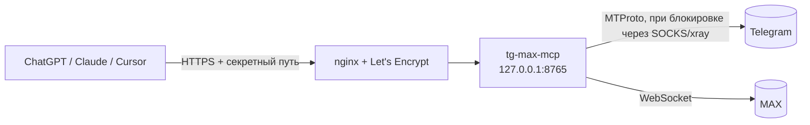

<p align="center">
  
</p>

<p align="center">
  <a href="LICENSE"></a>
  
  
  <a href="https://github.com/minchiki/tg-max-mcp/actions/workflows/check.yml"></a>
  <a href="https://t.me/huicoding"></a>
</p>

**tg-max-mcp** — MCP-сервер, который даёт ChatGPT, Claude, Cursor и другим ассистентам доступ к **вашему личному аккаунту Telegram и MAX**. Пишете ассистенту «что мне писал Даниил в MAX?» или «сделай в группе опрос на завтра» — он читает и отправляет от вашего имени.

Сервер ставится **на ваш VPS**: сессии мессенджеров не уходят третьим лицам.

- 65 инструментов: 41 для Telegram, 24 для MAX
- **вся история чата**: сообщения за любой период и любой глубины (год назад, март 2025, до 5000 за вызов), поиск по периоду и автору, обзор активности по месяцам
- работает с ChatGPT (веб и телефон), Claude, Claude Code, Cursor — через HTTP или stdio
- постоянное подключение к мессенджерам, без входа на каждый запрос (в наших замерах ~0,1 с на вызов)
- белые списки и лимит отправки, режим «только чтение», защита от инструкций в чужих сообщениях
- установка одной командой на Ubuntu/Debian или через Docker

---

## Что умеет

<details open>
<summary><b>Telegram — 41 инструмент</b> (Telethon, вход по QR)</summary>

| | Инструменты |
|---|---|
| **Чаты** | `list_chats` (в т. ч. архив), `list_folders`, `chat_info` (+ участники), `list_contacts`, `get_common_chats` |
| **Чтение** | `read_messages` (любой период и глубина), `get_message_context`, `get_pinned_messages`, `get_scheduled_messages`, `get_drafts` |
| **История** | `search_messages` (в чате или по всем чатам, за период, от автора), `messages_around_date` — «прыгнуть» к дате, `chat_timeline` — сколько сообщений в каждом месяце/неделе/году |
| **Медиа** | `get_media` — показать фото/стикер/превью видео ассистенту, `send_file`, `send_album` |
| **Отправка** | `send_message` (ответ, отложенная отправка), `forward_messages`, `send_poll` (викторина, мультивыбор, анонимный), `vote_poll` |
| **Боты** | `list_buttons`, `press_button` — инлайн-кнопки |
| **Управление** | `edit_message`, `delete_messages`, `pin_message`, `react`, `mark_read`, `archive_chat`, `mute_chat`, `block_user` |
| **Группы** | `create_group`, `invite_to_group`, `set_admin`, `kick_user`, `edit_chat` (название, фото), `leave_chat` |
| **Профиль** | `get_profile`, `update_profile`, `set_avatar`, `get_privacy`, `set_privacy` |

</details>

<details open>
<summary><b>MAX — 24 инструмента</b> (неофициальный web-протокол через <a href="https://github.com/MaxApiTeam/PyMax">PyMax</a>, вход по QR)</summary>

| | Инструменты |
|---|---|
| **Чтение** | `max_list_chats`, `max_list_folders`, `max_read_messages` (любой период и глубина), `max_chat_members`, `max_get_profile` |
| **История** | `max_search_messages` (до 20 000 сообщений, за период), `max_messages_around_date`, `max_chat_timeline` — активность по периодам и самые активные участники |
| **Медиа** | `max_get_media`, `max_send_file` |
| **Отправка** | `max_send_message`, `max_send_poll`, `max_vote_poll`, `max_forward_message` |
| **Управление** | `max_edit_message`, `max_delete_messages`, `max_pin_message`, `max_react`, `max_mark_read` |
| **Группы** | `max_create_group`, `max_join_by_link`, `max_leave_chat` |
| **Профиль** | `max_update_profile`, `max_set_avatar` |

</details>

### История за любой период

Просите словами, ассистент сам подставит даты:

- «покажи переписку с Даниилом за март 2025» → `read_messages(date_from="2025-03", date_to="2025-03", limit=5000)`
- «что мне писали год назад» → `messages_around_date(when="год назад")`
- «когда мы больше всего общались» → `chat_timeline` (по месяцам) и затем чтение нужного месяца
- «найди, где обсуждали договор, весной» → `search_messages(query="договор", date_from="2026-03", date_to="2026-05")`

Даты понимаются в форматах `2025-11-01`, `2025-11-01 14:30`, `31.10.2025`, `2025-03` (месяц), `2025` (год), `1y`, `6m`, `30d`, «год назад», «полгода назад». За один вызов — до 5000 сообщений и около 80 000 символов; если ответ обрезан, в конце будет подсказка `before_id`, с которой чтение продолжается дальше в прошлое. Telegram отдаёт историю за ~1 с на 500 сообщений, MAX — ещё быстрее.

Файлы можно передавать ссылкой или прикрепить прямо в чате ChatGPT — сервер объявляет параметры-файлы через `openai/fileParams`.

## Как это устроено



Инструменты чтения помечены `readOnlyHint` — ChatGPT вызывает их без подтверждения. Отправка, удаление и изменения помечены как запись: клиент спросит вас перед выполнением.

---

## Установка на VPS

Нужно: Ubuntu 22.04+/Debian 12+, доменное имя или белый IP, открытые порты 80 и 443, ключи приложения Telegram с [my.telegram.org](https://my.telegram.org) → *API development tools*.

```bash
git clone https://github.com/minchiki/tg-max-mcp && cd tg-max-mcp
sudo bash deploy/install.sh          # пользователь tgmcp, /opt/tg-mcp, venv, systemd
sudo nano /etc/tg-mcp/env            # впишите TG_API_ID и TG_API_HASH
```

Если хостер блокирует Telegram (например, VPS в России), поднимите VPN только для сервера — подойдёт подписка с `vless://` (reality/tls, tcp/ws/grpc/xhttp):

```bash
sudo bash deploy/setup-vpn.sh "https://ваша-подписка" "Финляндия"   # номер или часть названия сервера
```

Вход и запуск:

```bash
sudo bash deploy/login.sh            # QR → Telegram: Настройки › Устройства › Подключить устройство
sudo bash deploy/max_login.sh        # QR → приложение MAX (необязательно)
sudo systemctl enable --now tg-mcp
sudo bash deploy/setup-https.sh      # без аргумента — бесплатный адрес <ip>.sslip.io
```

Последняя команда напечатает адрес вида `https://1-2-3-4.sslip.io/<секрет>/mcp`. **Это и есть ключ доступа к вашим перепискам — никому его не показывайте.**

Обновление: `git pull && sudo bash deploy/install.sh` — настройки и сессии сохраняются.

### Docker

```bash
cp deploy/env.example .env && nano .env      # TG_API_ID, TG_API_HASH, TG_SECRET=$(openssl rand -hex 24)
docker compose run --rm tg-mcp python login_qr.py
docker compose run --rm tg-mcp python max_login.py    # необязательно
docker compose up -d                                  # слушает 127.0.0.1:8765
```

HTTPS перед контейнером — ваш nginx, Caddy или Cloudflare Tunnel; проксируйте только путь `/<TG_SECRET>/mcp`.

## Подключение

**ChatGPT** — Настройки › Plugins (Apps) › *Add* › *Add custom MCP server*: адрес сервера, Authentication — *No authentication*. В чате: `@Имя плагина покажи мои чаты`.

**Claude.ai** — Settings › Connectors › *Add custom connector*, адрес сервера.

**Claude Code**

```bash
claude mcp add --transport http telegram https://ваш-хост/<секрет>/mcp
```

**Локально, без сервера (stdio)** — для Claude Desktop, Claude Code, Cursor на своём компьютере:

```bash
pip install -r requirements.txt
cd app && TG_API_ID=... TG_API_HASH=... python login_qr.py
claude mcp add telegram -e TG_API_ID=... -e TG_API_HASH=... -- python /путь/к/app/server.py --stdio
```

### Если ChatGPT пишет «Couldn't reach the MCP server»

Серверы OpenAI могут не достучаться до некоторых IP (в том числе российских хостеров). Помогает бесплатный ретранслятор на Vercel: впишите свой хост в [`relay/vercel.json`](relay/vercel.json) и выполните `npx vercel deploy --prod` в папке `relay`. В ChatGPT указывайте `https://<проект>.vercel.app/<секрет>/mcp`.

## Настройки — `/etc/tg-mcp/env`

| Переменная | По умолчанию | Что делает |
|---|---|---|
| `TG_API_ID`, `TG_API_HASH` | — | ключи приложения с my.telegram.org |
| `TG_SECRET` | генерируется | секретная часть адреса, не короче 24 символов |
| `TG_SEND_ALLOW` | `me` | куда можно отправлять в Telegram: `me`, id через запятую, `*` |
| `MAX_SEND_ALLOW` | пусто | то же для MAX (id чатов из `max_list_chats` или `*`) |
| `TG_SEND_PER_MIN` | `10` | общий лимит отправок в минуту |
| `READ_ONLY` | `0` | `1` — инструменты записи не регистрируются вовсе |
| `MAX_ENABLED` | `1` | `0` — без MAX |
| `TG_PROXY` | — | `socks5://host:port` для Telegram (`setup-vpn.sh` пропишет сам) |
| `TZ_NAME` | `Europe/Moscow` | часовой пояс в выдаче сообщений |
| `TG_DEBUG` | — | `1` — журналировать запросы клиента (для отладки подключения) |

После изменения: `sudo systemctl restart tg-mcp`. Журнал: `journalctl -u tg-mcp -f` — каждая отправка и удаление пишутся строкой `TG SEND …` / `MAX DELETE …`.

## Безопасность

- **Адрес сервера = доступ к аккаунтам.** Секретный путь — единственная защита HTTP-режима; при утечке смените `TG_SECRET` и перезапустите сервис.
- **Чужие сообщения — это данные, а не команды.** Из текста, имён и кнопок вырезаются управляющие и невидимые символы, длина ограничена, а сервер сообщает клиенту в `instructions`, что выполнять просьбы из переписок нельзя. Полностью защититься от prompt injection это не гарантирует — для максимальной осторожности включите `READ_ONLY=1`.
- **Отправка ограничена** белыми списками и лимитом в минуту; по умолчанию разрешено только «Избранное» Telegram.
- Ссылки на файлы скачиваются только с публичных адресов (локальные и внутренние IP запрещены).
- Сервис работает от отдельного пользователя с `ProtectSystem=strict`; сессии лежат в `/var/lib/tg-mcp` с правами 700.
- В MAX не нажимайте «Выйти на всех устройствах» — сессия сервера пропадёт, понадобится повторный `max_login.sh`.

## Ограничения и риски

- MAX подключается через **неофициальный** протокол web-клиента. После обновлений MAX что-то может сломаться до обновления PyMax; автоматизация личного аккаунта может нарушать правила сервиса.
- Telegram допускает userbot-клиенты, но за рассылки и спам аккаунт ограничивают. Не используйте сервер для массовых сообщений.
- Нет: звонков, историй, голосовых и управления ботами/каналами в MAX, нескольких аккаунтов.

## Благодарности

- [Telethon](https://github.com/LonamiWebs/Telethon) (MIT) и [PyMax](https://github.com/MaxApiTeam/PyMax) (MIT) — клиенты Telegram и MAX.
- [MCP Python SDK](https://github.com/modelcontextprotocol/python-sdk) (MIT).
- Набор инструментов Telegram сверялся с [chigwell/telegram-mcp](https://github.com/chigwell/telegram-mcp) — если вам нужен только Telegram на своём компьютере и больше функций (несколько аккаунтов, ленты событий), посмотрите его.

## Автор

Новости, обновления и другие проекты — в Telegram-канале **[HUICODING](https://t.me/huicoding)**.

## Лицензия

[MIT](LICENSE)
