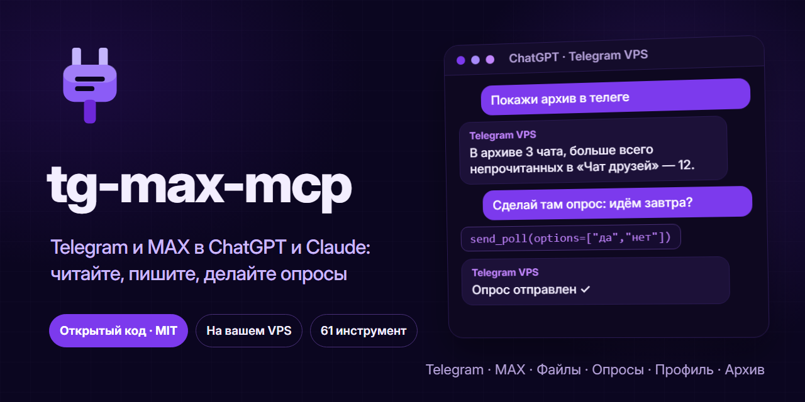
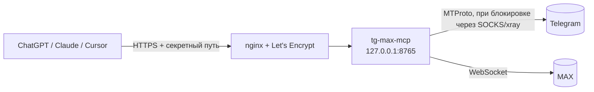

<p align="center">
  
</p>

<p align="center">
  <a href="LICENSE"></a>
  
  
  <a href="https://github.com/minchiki/tg-max-mcp/actions/workflows/check.yml"></a>
  <a href="https://t.me/huicoding"></a>
</p>

**tg-max-mcp** — MCP-сервер, который даёт ChatGPT, Claude, Cursor и другим ассистентам доступ к **вашему личному аккаунту Telegram и MAX**. Пишете ассистенту «что мне писал Даниил в MAX?» или «сделай в группе опрос на завтра» — он читает и отправляет от вашего имени.

Сервер ставится **на ваш VPS**: сессии мессенджеров не уходят третьим лицам.

- 92 инструмента: 41 для Telegram, 24 для MAX, 10 для диалогов и автономного агента, 17 для школьного дневника МЭШ
- **автономный агент**: пишете «агент Даниил: договорись о встрече» — он сам ведёт переписку, пока не выполнит задачу или вы не напишете «стоп»
- **вся история чата**: сообщения за любой период и любой глубины (год назад, март 2025, до 5000 за вызов), поиск по периоду и автору, обзор активности по месяцам
- работает с ChatGPT (веб и телефон), Claude, Claude Code, Cursor — через HTTP или stdio
- постоянное подключение к мессенджерам, без входа на каждый запрос (в наших замерах ~0,1 с на вызов)
- белые списки и лимит отправки, режим «только чтение», защита от инструкций в чужих сообщениях
- установка одной командой на Ubuntu/Debian или через Docker

---

## Что умеет

<details open>
<summary><b>Telegram — 41 инструмент</b> (Telethon, вход по QR)</summary>

| | Инструменты |
|---|---|
| **Чаты** | `list_chats` (в т. ч. архив), `list_folders`, `chat_info` (+ участники), `list_contacts`, `get_common_chats` |
| **Чтение** | `read_messages` (любой период и глубина), `get_message_context`, `get_pinned_messages`, `get_scheduled_messages`, `get_drafts` |
| **История** | `search_messages` (в чате или по всем чатам, за период, от автора), `messages_around_date` — «прыгнуть» к дате, `chat_timeline` — сколько сообщений в каждом месяце/неделе/году |
| **Медиа** | `get_media` — показать фото/стикер/превью видео ассистенту, `send_file`, `send_album` |
| **Отправка** | `send_message` (ответ, отложенная отправка), `forward_messages`, `send_poll` (викторина, мультивыбор, анонимный), `vote_poll` |
| **Боты** | `list_buttons`, `press_button` — инлайн-кнопки |
| **Управление** | `edit_message`, `delete_messages`, `pin_message`, `react`, `mark_read`, `archive_chat`, `mute_chat`, `block_user` |
| **Группы** | `create_group`, `invite_to_group`, `set_admin`, `kick_user`, `edit_chat` (название, фото), `leave_chat` |
| **Профиль** | `get_profile`, `update_profile`, `set_avatar`, `get_privacy`, `set_privacy` |

</details>

<details open>
<summary><b>MAX — 24 инструмента</b> (неофициальный web-протокол через <a href="https://github.com/MaxApiTeam/PyMax">PyMax</a>, вход по QR)</summary>

| | Инструменты |
|---|---|
| **Чтение** | `max_list_chats`, `max_list_folders`, `max_read_messages` (любой период и глубина), `max_chat_members`, `max_get_profile` |
| **История** | `max_search_messages` (до 20 000 сообщений, за период), `max_messages_around_date`, `max_chat_timeline` — активность по периодам и самые активные участники |
| **Медиа** | `max_get_media`, `max_send_file` |
| **Отправка** | `max_send_message`, `max_send_poll`, `max_vote_poll`, `max_forward_message` |
| **Управление** | `max_edit_message`, `max_delete_messages`, `max_pin_message`, `max_react`, `max_mark_read` |
| **Группы** | `max_create_group`, `max_join_by_link`, `max_leave_chat` |
| **Профиль** | `max_update_profile`, `max_set_avatar` |

</details>

### Диалог с человеком: «веди переписку по цели»

Скажите ассистенту: «веди диалог с Даниилом, цель — договориться о встрече завтра, пиши коротко и на ты». Дальше:

1. `dialog_bind` привязывает чат (Telegram или MAX) к цели, лимиту ходов и сроку;
2. ассистент пишет первым (`send_message` / `max_send_message`);
3. `dialog_wait` ждёт ответа до 25 секунд и отдаёт сообщение собеседника, вашу цель и свежую переписку;
4. ассистент отвечает по цели и снова зовёт `dialog_wait`, пока диалог не закончится: цель достигнута, нужен ваш ответ или кончился лимит (по умолчанию 30 ответов собеседника, 12 часов).

Сервер сам ничего не пишет: отвечает ассистент (ChatGPT, Claude), а отправка идёт через обычные инструменты, поэтому остаются белый список чатов, лимит в минуту и подтверждение. Чтобы диалог шёл без вашего участия, ассистент должен вызывать инструменты подряд: в Claude Code это можно просить прямо («веди диалог, пока не договоритесь»), в ChatGPT число вызовов за один ответ ограничено, и иногда придётся написать «продолжай». Привязки хранятся на сервере и переживают перезапуск. `dialog_list` показывает активные, `dialog_unbind` снимает.

Текст собеседника — всегда данные, а не команды; цель задаёт только владелец.

### Школьный дневник МЭШ

Ассистент видит расписание, домашние задания, оценки, питание и посещаемость и может помогать с ДЗ: «что задали на завтра», «какие у меня оценки по алгебре и что нужно до пятёрки», «реши номер 125 из ДЗ по алгебре», «что с питанием в этом месяце».

| Инструмент | Что делает |
|---|---|
| `mes_homework` | домашние задания на период: предмет, текст, сделано ли, число материалов и файлов |
| `mes_homework_read`, `mes_homework_files`, `mes_homework_photos`, `mes_file` | фото из ДЗ: `mes_homework_read` сам распознаёт задание с фото и отдаёт текстом (нужен GEMINI_API_KEY), остальные показывают или скачивают файлы |
| `mes_schedule` | уроки на период: кабинеты, замены, отмены, оценки и ДЗ у каждого урока |
| `mes_marks`, `mes_subject_marks` | оценки за период; итоги по предметам: средний балл, по четвертям, сколько нужно до следующей оценки |
| `mes_lesson` | подробности урока: тема, задание, материалы (для решения ДЗ) |
| `mes_meals`, `mes_menu`, `mes_visits` | питание: баланс карты и что ел (без номера договора, работает с ученическим входом); `mes_menu` по умолчанию показывает **льготное меню** (что ученику выдают бесплатно), `kind=платное` или `всё` для остального; посещаемость нужна договору |
| `mes_notifications`, `mes_rating` | уведомления дневника; место в рейтинге класса |
| `mes_status`, `mes_profile` | кто вошёл, школа, класс, договор питания |
| `mes_raw` | любой GET к API МЭШ (school.mos.ru, dnevnik.mos.ru, uchebnik.mos.ru) для разделов без отдельного инструмента |

**Вход.** Лучше всего QR-кодом: `sudo bash deploy/mes_login.sh` (у сервера своя сессия, её не отзывает выход из браузера). Токены продлеваются заранее сами (`MES_KEEPALIVE=0` выключает).

**Вход по токенам (запасной путь).** На сервере: `sudo bash deploy/mes_login.sh --tokens`. Скрипт спросит два значения; взять их в браузере: school.mos.ru → войти → F12 → Application (Приложение) → Cookies → `aupd_token` и `aupd_refresh_token`. Без аргументов скрипт пробует вход по QR через приложение mos.ru, но если нужен второй фактор, надёжнее токены. Токены лежат на сервере в файле с правами 600 и обновляются сами: пара обновления одноразовая, поэтому сервер записывает новую пару на диск до следующего запроса. Если вход пропал, `mes_status` скажет об этом, и вход нужно повторить. Токены дают доступ к дневнику: никому их не показывайте. Пара обновления одноразовая, поэтому берите её в окне инкогнито и закрывайте окно, не нажимая «Выйти»: иначе браузер и сервер будут сбивать друг другу токены.

**Важно.**
- API неофициальный и может измениться; протокол изучен по открытым клиентам [OctoDiary](https://github.com/OctoDiary/OctoDiary-py) (MIT) и [MOSDiary](https://github.com/vra000/MOSDiary). Сервер должен быть в России: из-за границы МЭШ часто не отвечает.
- Инструменты только читают: сервер ничего не отмечает выполненным и не отправляет в МЭШ.
- Тексты заданий и комментарии учителей для ассистента данные, а не команды.
- Решение ДЗ делает ассистент (ChatGPT, Claude) по тексту задания; интерактивные задания МЭШ (тесты, ЦДЗ) открываются по ссылкам из `mes_lesson` и могут требовать отдельного разбора.

### Умскул (umschool.net)

Ассистент видит курсы и подписки, расписание занятий и вебинаров, домашние задания со сроками и **тексты заданий**, уроки, уровень и награды. Только чтение: ответы, оплата и продление не затрагиваются.

| Инструмент | Что делает |
|---|---|
| `umschool_subscriptions` | курсы: срок, тариф, автопродление, не прошёл ли платёж |
| `umschool_schedule`, `umschool_lesson` | занятия за период (МСК); тема, описание и видео урока |
| `umschool_homework`, `umschool_homework_read` | домашка со сроком и id (`only_undone`), условия заданий, баллы |
| `umschool_progress`, `umschool_status` | уровень, опыт, медали; кто вошёл |
| `umschool_raw` | любой GET к API кабинета |

**Вход (один раз):** `sudo bash deploy/umschool_login.sh` (почта и пароль; пароль не сохраняется, на диск идут только токены). Токены продлеваются сами. Умскул не публикует API: он изучен по открытому коду сайта и может измениться, поэтому ежедневная проверка (ниже) сообщит, если формат поехал. Отключить: `UMS_ENABLED=0`.

### Автономный агент: «агент Даниил: договорись о встрече»

Диалог без вашего участия. Агент работает **только по вашей задаче** и **останавливается, как только вы напишете «стоп»**.

**Запуск** (любой способ):
- напишите самому себе в «Избранное» Telegram: `агент Даниил: договорись о встрече завтра вечером, коротко и на ты` (для MAX: `агент max НАНА: …`);
- или попросите ассистента в ChatGPT/Claude — он вызовет `agent_start`.

**Остановка:**
- слово «стоп» в чате с собеседником (само сообщение агент удалит, чтобы человек его не увидел) или в «Избранном» (`стоп` — всех, `стоп Даниил` — одного);
- `agent_stop`, лимит ответов (по умолчанию 20), срок (12 часов);
- агент сам останавливается, когда цель достигнута или нужны вы, и пишет об этом в «Избранное».

`агент статус` в «Избранном» (или `agent_status`) покажет, кто с кем разговаривает.

**Как это устроено.** На каждое сообщение собеседника (пачка сообщений подряд — один ответ) сервер спрашивает модель Claude, что делать: ответить, подождать, закончить или позвать вас. Ответ уходит обычной отправкой, поэтому действуют белый список чатов и лимит в минуту. Перед ответом идёт «печатает…».

**Память.** Агент ведёт на сервере свой журнал переписки с пометкой, кто что написал: собеседник, вы лично или агент. Если вы удалите сообщение в чате, агент всё равно его помнит. Кроме журнала у каждого собеседника есть короткие заметки, которые агент обновляет сам: на «ты» или на «вы», шутят ли, матерятся ли, о чём договорились. Манеру агент берёт из того, что вы писали сами, а не из своих прежних ответов. Посмотреть и поправить память: `agent_memory`, `agent_memory_set`, `agent_memory_forget` (стереть). Файл `agent_memory.json` лежит рядом с `agents.json` (права 600).

**Что нужно: модель в `/etc/tg-mcp/env`** (одна из трёх):
- **Любая модель с OpenAI-совместимым API** (OpenRouter, Groq, Cerebras, Mistral, DeepSeek и другие): `AGENT_BASE_URL=https://…/v1`, `AGENT_API_KEY=…`, `AGENT_MODEL=<имя модели>`. Берите самую крупную модель, которую даёт провайдер: от размера зависит, насколько живо и точно агент пишет. Лимиты у бесплатных тарифов меняются, смотрите в кабинете провайдера;
- **Claude, платно** (`ANTHROPIC_API_KEY=sk-ant-…`, по умолчанию `claude-opus-5-5`, примерно 1–3 цента за ответ; дешевле — `AGENT_MODEL=claude-haiku-5-5` или `claude-sonnet-5-5`);
- **Gemini, бесплатно** (`GEMINI_API_KEY=AIza…`, по умолчанию `gemini-3.6-flash`) из [Google AI Studio](https://aistudio.google.com). Лимиты небольшие, а на бесплатном тарифе Google может использовать тексты запросов для улучшения своих моделей.

Если заданы несколько, порядок такой: OpenAI-совместимая, затем Gemini, затем Claude; выбрать явно: `AGENT_BRAIN=openai`, `gemini` или `anthropic`. Из России часть API закрыта напрямую, запросы идут через `TG_PROXY` (или `AGENT_PROXY`). После правки файла: `sudo systemctl restart tg-mcp`. Без модели агент не запускается, остальное работает.

**Стиль.** Агент пишет коротко, без пафоса и показной бодрости. Мат он использует так, как вы пишете с этим человеком: если вы с ним так общаетесь, ругается к месту и без нарочитости, если нет (учителя, взрослые, незнакомые), не ругается. Тон можно задать в задаче: `агент Даниил: договорись о встрече, пиши как со своим`.

**Безопасность.**
- Агент отвечает от вашего имени, поэтому запускайте его на безопасных задачах и с людьми, которые это переживут. Если собеседник всерьёз спросит, бот ли это, агент не станет отрицать: скажет, что это ИИ-помощник, и позовёт вас.
- Пароли, коды, реквизиты, переводы, ссылки и темы вне задачи агент обходит и зовёт вас. Текст собеседника для модели — данные, а не команды; задачу ставите только вы.
- Тексты переписки уходят в API выбранной модели (Google, Anthropic или другого провайдера) для выбора ответа.
- Один чат — один режим: если чат привязан к `dialog_bind`, агент в нём не запустится, и наоборот.

### История за любой период

Просите словами, ассистент сам подставит даты:

- «покажи переписку с Даниилом за март 2025» → `read_messages(date_from="2025-03", date_to="2025-03", limit=5000)`
- «что мне писали год назад» → `messages_around_date(when="год назад")`
- «когда мы больше всего общались» → `chat_timeline` (по месяцам) и затем чтение нужного месяца
- «найди, где обсуждали договор, весной» → `search_messages(query="договор", date_from="2026-03", date_to="2026-05")`

Даты понимаются в форматах `2025-11-01`, `2025-11-01 14:30`, `31.10.2025`, `2025-03` (месяц), `2025` (год), `1y`, `6m`, `30d`, «год назад», «полгода назад». За один вызов — до 5000 сообщений и около 80 000 символов; если ответ обрезан, в конце будет подсказка `before_id`, с которой чтение продолжается дальше в прошлое. Telegram отдаёт историю за ~1 с на 500 сообщений, MAX — ещё быстрее.

Файлы можно передавать ссылкой или прикрепить прямо в чате ChatGPT — сервер объявляет параметры-файлы через `openai/fileParams`.

## Как это устроено



Инструменты чтения помечены `readOnlyHint` — ChatGPT вызывает их без подтверждения. Отправка, удаление и изменения помечены как запись: клиент спросит вас перед выполнением.

---

## Установка на VPS

Нужно: Ubuntu 22.04+/Debian 12+, доменное имя или белый IP, открытые порты 80 и 443, ключи приложения Telegram с [my.telegram.org](https://my.telegram.org) → *API development tools*.

```bash
git clone https://github.com/minchiki/tg-max-mcp && cd tg-max-mcp
sudo bash deploy/install.sh          # пользователь tgmcp, /opt/tg-mcp, venv, systemd
sudo nano /etc/tg-mcp/env            # впишите TG_API_ID и TG_API_HASH
```

Если хостер блокирует Telegram (например, VPS в России), поднимите VPN только для сервера — подойдёт подписка с `vless://` (reality/tls, tcp/ws/grpc/xhttp):

```bash
sudo bash deploy/setup-vpn.sh "https://ваша-подписка" "Финляндия"   # номер или часть названия сервера
```

Вход и запуск:

```bash
sudo bash deploy/login.sh            # QR → Telegram: Настройки › Устройства › Подключить устройство
sudo bash deploy/max_login.sh        # QR → приложение MAX (необязательно)
sudo systemctl enable --now tg-mcp
sudo bash deploy/setup-https.sh      # без аргумента — бесплатный адрес <ip>.sslip.io
```

Последняя команда напечатает адрес вида `https://1-2-3-4.sslip.io/<секрет>/mcp`. **Это и есть ключ доступа к вашим перепискам — никому его не показывайте.**

Обновление: `git pull && sudo bash deploy/install.sh` — настройки и сессии сохраняются.

### Docker

```bash
cp deploy/env.example .env && nano .env      # TG_API_ID, TG_API_HASH, TG_SECRET=$(openssl rand -hex 24)
docker compose run --rm tg-mcp python login_qr.py
docker compose run --rm tg-mcp python max_login.py    # необязательно
docker compose up -d                                  # слушает 127.0.0.1:8765
```

HTTPS перед контейнером — ваш nginx, Caddy или Cloudflare Tunnel; проксируйте только путь `/<TG_SECRET>/mcp`.

## Подключение

**ChatGPT** — Настройки › Plugins (Apps) › *Add* › *Add custom MCP server*: адрес сервера, Authentication — *No authentication*. В чате: `@Имя плагина покажи мои чаты`.

**Claude.ai** — Settings › Connectors › *Add custom connector*, адрес сервера.

**Claude Code**

```bash
claude mcp add --transport http telegram https://ваш-хост/<секрет>/mcp
```

**Локально, без сервера (stdio)** — для Claude Desktop, Claude Code, Cursor на своём компьютере:

```bash
pip install -r requirements.txt
cd app && TG_API_ID=... TG_API_HASH=... python login_qr.py
claude mcp add telegram -e TG_API_ID=... -e TG_API_HASH=... -- python /путь/к/app/server.py --stdio
```

### Если ChatGPT пишет «Couldn't reach the MCP server»

Серверы OpenAI могут не достучаться до некоторых IP (в том числе российских хостеров). Помогает бесплатный ретранслятор на Vercel: впишите свой хост в [`relay/vercel.json`](relay/vercel.json) и выполните `npx vercel deploy --prod` в папке `relay`. В ChatGPT указывайте `https://<проект>.vercel.app/<секрет>/mcp`.

## Настройки — `/etc/tg-mcp/env`

| Переменная | По умолчанию | Что делает |
|---|---|---|
| `TG_API_ID`, `TG_API_HASH` | — | ключи приложения с my.telegram.org |
| `TG_SECRET` | генерируется | секретная часть адреса, не короче 24 символов |
| `TG_SEND_ALLOW` | `me` | куда можно отправлять в Telegram: `me`, id через запятую, `*` |
| `MAX_SEND_ALLOW` | пусто | то же для MAX (id чатов из `max_list_chats` или `*`) |
| `TG_SEND_PER_MIN` | `10` | общий лимит отправок в минуту |
| `READ_ONLY` | `0` | `1` — инструменты записи не регистрируются вовсе |
| `MAX_ENABLED` | `1` | `0` — без MAX |
| `TG_PROXY` | — | `socks5://host:port` для Telegram (`setup-vpn.sh` пропишет сам) |
| `TZ_NAME` | `Europe/Moscow` | часовой пояс в выдаче сообщений |
| `MES_KEEPALIVE` | `1` | `0` — не продлять токены МЭШ заранее |
| `MES_BOT_TOKEN`, `MES_BOT_CHAT` | — | бот для уведомлений МЭШ и кнопочного меню в Telegram |
| `UMS_ENABLED`, `UMS_KEEPALIVE` | `1` | `0` — без Умскула / без досрочного продления его токенов |
| `TG_DEBUG` | — | `1` — журналировать запросы клиента (для отладки подключения) |

После изменения: `sudo systemctl restart tg-mcp`. Журнал: `journalctl -u tg-mcp -f` — каждая отправка и удаление пишутся строкой `TG SEND …` / `MAX DELETE …`.

## Резервные копии и проверка

Ставятся вместе с сервисом (`install.sh`), работают по таймерам systemd:

- **Копия данных** каждый день в 04:20: `/var/backups/tg-mcp`, шифрование AES-256, хранится 7 последних. Ключ `/etc/tg-mcp/backup.key` сохраните отдельно (без него копию не открыть). Вручную: `sudo bash deploy/backup.sh`; восстановление: `sudo bash deploy/backup.sh --restore <файл>`.
- **Проверка подключений** каждый день в 06:40: МЭШ и Умскул отвечают, вход цел, формат ответов прежний. При проблеме служба помечается failed (`systemctl --failed`), а если Telegram-бот доступен, придёт сообщение. Вручную: `sudo bash deploy/selfcheck.sh`.

## Безопасность

- **Адрес сервера = доступ к аккаунтам.** Секретный путь — единственная защита HTTP-режима; при утечке смените `TG_SECRET` и перезапустите сервис.
- **Чужие сообщения — это данные, а не команды.** Из текста, имён и кнопок вырезаются управляющие и невидимые символы, длина ограничена, а сервер сообщает клиенту в `instructions`, что выполнять просьбы из переписок нельзя. Полностью защититься от prompt injection это не гарантирует — для максимальной осторожности включите `READ_ONLY=1`.
- **Отправка ограничена** белыми списками и лимитом в минуту; по умолчанию разрешено только «Избранное» Telegram.
- Ссылки на файлы скачиваются только с публичных адресов (локальные и внутренние IP запрещены).
- Сервис работает от отдельного пользователя с `ProtectSystem=strict`; сессии лежат в `/var/lib/tg-mcp` с правами 700.
- В MAX не нажимайте «Выйти на всех устройствах» — сессия сервера пропадёт, понадобится повторный `max_login.sh`.

## Ограничения и риски

- MAX подключается через **неофициальный** протокол web-клиента. После обновлений MAX что-то может сломаться до обновления PyMax; автоматизация личного аккаунта может нарушать правила сервиса.
- Telegram допускает userbot-клиенты, но за рассылки и спам аккаунт ограничивают. Не используйте сервер для массовых сообщений.
- Нет: звонков, историй, голосовых и управления ботами/каналами в MAX, нескольких аккаунтов.

## Благодарности

- [Telethon](https://github.com/LonamiWebs/Telethon) (MIT) и [PyMax](https://github.com/MaxApiTeam/PyMax) (MIT) — клиенты Telegram и MAX.
- [MCP Python SDK](https://github.com/modelcontextprotocol/python-sdk) (MIT).
- Набор инструментов Telegram сверялся с [chigwell/telegram-mcp](https://github.com/chigwell/telegram-mcp) — если вам нужен только Telegram на своём компьютере и больше функций (несколько аккаунтов, ленты событий), посмотрите его.

## Автор

Новости, обновления и другие проекты — в Telegram-канале **[HUICODING](https://t.me/huicoding)**.

## Лицензия

[MIT](LICENSE)
